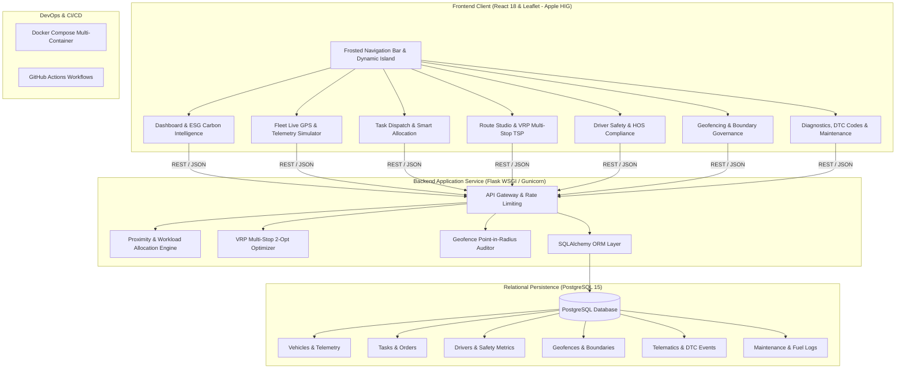

# Fleet Management System (FleetOS Enterprise)

An enterprise-ready, full-stack fleet management and commercial telematics platform designed for modern logistics operators, dispatchers, and delivery fleets. This platform automates vehicle task allocation, multi-stop route optimization (Vehicle Routing Problem / VRP with 2-Opt), live GPS asset tracking, driver safety scorecards, geofence compliance audits, OBD-II diagnostic fault tracking, and ESG carbon emissions calculation.

Containerized with Docker and automated with GitHub Actions CI/CD workflows, this project demonstrates end-to-end modern application development, containerization, and automated delivery.

---

## Apple-Grade Human Interface Design

The frontend user experience has been crafted following **Apple Human Interface Guidelines (HIG)**:
- **Materials & Vibrancy**: Dark-mode frosted glass headers (`backdrop-filter: blur(24px)`), translucent floating panels, and subtle border highlights.
- **Dynamic Island Feedback**: Floating pill status toasts that expand and animate dynamically for system notifications and alerts.
- **Micro-Interactions**: Springy physics, smooth segmented navigation tabs, interactive hover states, and iOS-style toggle switches and progress gauges.
- **Apple Maps Aesthetics**: Sleek pill-shaped asset markers on dark tile maps, real-time telemetry drift simulations, and slide-in asset inspection sheets.

---

## Architecture Overview



---

## Core Enterprise Modules

1. **Dashboard & ESG Analytics**:
   - Executive fleet utilization ring gauges and active asset counters.
   - ESG Carbon Intelligence: Total $CO_2$ footprint (kg) and EV green offsets.
   - One-click executive summary CSV export.

2. **Fleet Map & Asset Inspector**:
   - Live Leaflet GIS map with custom pill-shaped vehicle tags.
   - Live GPS drift simulation displaying changing speeds and battery levels.
   - Slide-in Asset Telemetry Inspector displaying OBD-II DTC diagnostic codes, tire pressure (PSI), engine hours, and battery temperatures.

3. **Task Dispatch & Algorithmic Allocation**:
   - Priority-based order queue (Critical, High, Medium, Low).
   - Smart Allocation Algorithm weighting distance, battery reserve (>20% threshold), and driver workload balance.

4. **Route Studio & VRP Multi-Stop Optimization**:
   - Multi-Stop Vehicle Routing Problem (VRP / TSP) solved with Nearest-Neighbor + 2-Opt heuristic.
   - Turn-by-turn waypoint itinerary with cumulative distance, traffic congestion multipliers, fuel burn, and $CO_2$ emission projections.

5. **Driver Safety & Telematics Scorecards**:
   - Safety score scoring (0-100) factoring in harsh braking, rapid acceleration, and speeding events.
   - Hours of Service (HOS) regulatory compliance tracking with warning alerts.

6. **Geofencing & Perimeter Governance**:
   - Create and monitor circular geofences with customizable radii.
   - Live fleet compliance audit calculating distance to boundaries and entry/exit status.

7. **Vehicle Diagnostics & Maintenance**:
   - OBD-II Diagnostic Trouble Code (DTC) scanner and fault clearing.
   - Scheduled maintenance orders and fuel consumption auditing.

---

## Technical Stack

| Layer | Technologies |
|---|---|
| **Backend API** | Python 3.9+, Flask, Flask-CORS, SQLAlchemy ORM, Gunicorn |
| **Database** | PostgreSQL 15 (with automated SQLite fallback for local test mode) |
| **Algorithms** | Haversine distance, 2-Opt VRP heuristic, Normalized proximity scoring |
| **Frontend UI** | React 18, React-Leaflet, Leaflet GIS, Axios, Apple HIG CSS System |
| **Containerization** | Docker, Docker Compose (Multi-stage builds, Healthchecks) |
| **CI/CD Automation** | GitHub Actions (Backend pytest, Frontend Jest & Build, Docker check) |

---

## Directory Structure

```text
Fleet-Management-System/
├── backend/
│   ├── app.py                     # Central Flask REST API gateway
│   ├── database.py                # PostgreSQL / SQLAlchemy pooled connection & seed data
│   ├── Dockerfile                 # Gunicorn + Python 3.9 slim container
│   ├── models/
│   │   ├── models.py              # Relational models: Vehicle, Driver, Task, Geofence, etc.
│   │   └── vehicle.py             # Vehicle operational model
│   ├── services/
│   │   ├── task_allocation.py     # Proximity, battery & workload allocation algorithm
│   │   ├── route_optimizer.py     # Waypoint calculation & traffic estimation
│   │   ├── vrp_optimizer.py       # Multi-stop VRP / TSP 2-Opt heuristic solver
│   │   └── geofence_service.py    # Geofence point-in-radius evaluation engine
│   ├── tests/
│   │   ├── test_api.py            # API endpoint integration tests (12 tests)
│   │   ├── test_task_allocation.py# Task allocation unit tests (6 tests)
│   │   ├── test_route_optimizer.py# Route optimization unit tests (5 tests)
│   │   ├── test_vrp_optimizer.py  # VRP optimization unit tests (3 tests)
│   │   └── test_geofences.py      # Geofencing unit tests (2 tests)
│   ├── pytest.ini                 # Pytest configuration
│   └── requirements.txt           # Pinned backend dependencies
├── frontend/
│   ├── Dockerfile                 # Multi-stage Node + Nginx container
│   ├── nginx.conf                 # Nginx reverse proxy configuration
│   ├── package.json               # Frontend dependencies and scripts
│   ├── public/
│   │   ├── index.html             # HTML5 entrypoint with Leaflet CSS
│   │   └── styles.css
│   └── src/
│       ├── App.js                 # Primary Apple-styled navigation & tabs
│       ├── App.test.js            # Automated UI test suite
│       ├── index.js               # React 18 DOM root
│       ├── styles.css             # Apple Human Interface Guidelines CSS system
│       ├── components/
│       │   ├── Dashboard.js       # Live KPI & ESG Command Center
│       │   ├── FleetMap.js        # Leaflet GPS tracking & Telemetry Inspector
│       │   ├── TaskManager.js     # Task creation & auto-allocation UI
│       │   ├── RoutePlanner.js    # AI Route Studio (VRP & Corridor Modes)
│       │   ├── DriverSafety.js    # Safety scorecards & HOS tracking
│       │   ├── GeofenceManager.js # Perimeter governance & zone audits
│       │   └── MaintenanceFuel.js # DTC scanner & maintenance scheduler
│       └── services/
│           └── api.js             # Unified Axios API client
├── .github/
│   └── workflows/
│       ├── ci.yml                 # Automated CI (pytest, npm test, docker validation)
│       └── deploy.yml             # Container build & delivery pipeline
├── docker-compose.yml             # PostgreSQL, Backend, & Frontend orchestration
├── requirements.txt               # Root Python dependencies
└── README.md                      # Documentation
```

---

## Getting Started

### Option 1: Running with Docker Compose (Production Environment)

Ensure Docker and Docker Compose are installed, then run:

```bash
docker compose up --build
```

- **Frontend Application**: [http://localhost:3000](http://localhost:3000)
- **Backend API Gateway**: [http://localhost:5000/api/health](http://localhost:5000/api/health)
- **PostgreSQL Database**: `localhost:5432` (`fleet_db`)

---

### Option 2: Running Locally for Development

#### 1. Backend Setup

```bash
cd backend
python3 -m venv venv
source venv/bin/activate
pip install -r requirements.txt

# Run backend on port 5001 (avoids macOS AirPlay conflict on 5000)
PORT=5001 python app.py
```

The backend starts at `http://localhost:5001` (with automatic schema creation and demo telemetry seeding).

#### 2. Frontend Setup

In a separate terminal:

```bash
cd frontend
npm install --legacy-peer-deps
npm start
```

The application opens at `http://localhost:3000`.

---

## API Reference

| Endpoint | Method | Description |
|---|---|---|
| `/api/health` | `GET` | Health check and service status |
| `/api/dashboard/stats` | `GET` | Fleet KPIs: vehicle count, active assets, alerts, fuel efficiency |
| `/api/reports/summary` | `GET` | Executive telemetry summary and ESG carbon report |
| `/api/vehicles` | `GET`, `POST` | List all vehicles or register a new fleet asset |
| `/api/vehicles/<id>` | `GET`, `PATCH`, `DELETE` | Retrieve, update status/coordinates, or delete a vehicle |
| `/api/drivers` | `GET`, `POST` | List or register drivers |
| `/api/drivers/assign` | `POST` | Assign an on-duty driver to a vehicle asset |
| `/api/drivers/scorecards` | `GET` | Driver safety scorecards, HOS hours, and violations |
| `/api/tasks` | `GET`, `POST` | Retrieve all dispatch tasks or create a new delivery order |
| `/api/tasks/<id>` | `PATCH`, `DELETE` | Update task status or delete task |
| `/api/allocate_task` | `POST` | Execute algorithmic task allocation across fleet vehicles |
| `/api/optimize_route` | `POST` | Point-to-point corridor optimization with traffic |
| `/api/routes/vrp_optimize` | `POST` | Multi-stop VRP tour optimization using 2-Opt heuristic |
| `/api/geofences` | `GET`, `POST` | Retrieve or create virtual geographic boundaries |
| `/api/geofences/<id>` | `DELETE` | Remove a geofence perimeter |
| `/api/geofences/evaluate` | `POST` | Audit vehicle positions against all registered geofences |
| `/api/telematics/events` | `GET`, `POST` | Log or fetch OBD-II DTC trouble codes and events |
| `/api/maintenance` | `GET`, `POST` | List scheduled maintenance orders or log a new service order |
| `/api/vehicles/<id>/fuel`| `GET`, `POST` | Retrieve vehicle fuel logs or audit a refueling entry |

---

## Verification & Testing

### Backend Test Suite (28 Tests)

```bash
cd backend
./venv/bin/pytest -v
```

All 28 tests cover API endpoints, task allocation algorithm with battery thresholds, VRP multi-stop heuristic, geofence radius checks, and traffic models.

### Frontend Test Suite & Production Build

```bash
cd frontend
npm test -- --watchAll=false
npm run build
```

---

## License

This project is licensed under the MIT License - see the [LICENSE](LICENSE) file for details.
