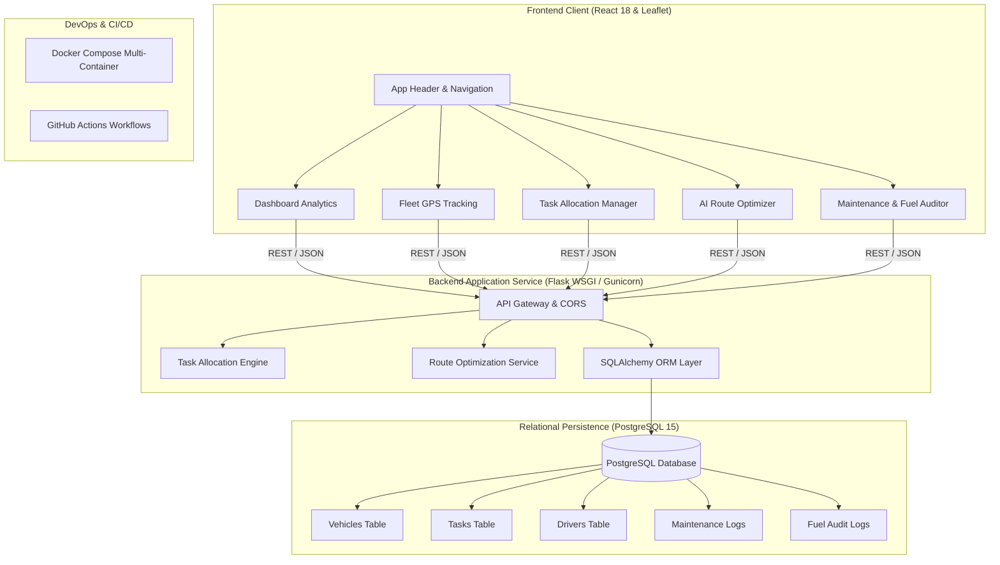

# Fleet Management System (FleetOS) — MicroSaaS Platform

An enterprise-ready, full-stack fleet management microSaaS application designed for logistics operators and delivery fleets. This platform automates vehicle task allocation, real-time route optimization with traffic congestion estimation, fleet GPS tracking, maintenance alerting, and fuel auditing.

Containerized with Docker and automated with GitHub Actions CI/CD workflows, this project demonstrates end-to-end modern application development, containerization, and automated delivery.

---

## Architecture Overview



---

## Core Capabilities

- **Automated Task Allocation Engine**: Dynamically scores and assigns pending logistics orders to vehicles based on geographic proximity, battery reserves, workload balance, and operational health thresholds (> 20% battery).
- **Route Optimizer & Congestion Modeling**: Calculates great-circle Haversine distances, generates navigational waypoints, and adjusts trip duration based on real-time traffic congestion factors.
- **Interactive Geospatial Map**: Leaflet-powered GPS telemetry map displaying live fleet asset locations, driver assignments, battery levels, and operating statuses.
- **Structured Relational Storage**: Backed by **PostgreSQL** with SQLAlchemy ORM models ensuring ACID transactional safety for vehicles, drivers, tasks, routes, and maintenance records.
- **Multi-Stage Containerization**: Production Dockerfiles for backend (Python slim + Gunicorn) and frontend (Node build + Nginx reverse proxy), orchestrated with Docker Compose.
- **Automated CI/CD**: GitHub Actions workflows validating backend tests (`pytest`), frontend builds (`npm test` & `npm run build`), and Docker configurations on every push and PR.

---

## Technical Stack

| Layer | Technologies |
|---|---|
| **Backend API** | Python 3.9+, Flask, Flask-CORS, SQLAlchemy, Gunicorn |
| **Database** | PostgreSQL 15 (with automated SQLite fallback for local developer mode) |
| **Routing & Logic** | Haversine algorithm, NumPy, Scikit-learn, Proximity Scoring |
| **Frontend UI** | React 18, React-Leaflet, Leaflet GIS, Axios, Modern Responsive CSS |
| **Containerization** | Docker, Docker Compose (Multi-stage builds, Healthchecks) |
| **CI/CD Automation** | GitHub Actions (Automated unit tests, build validation, Docker deployment) |

---

## Directory Structure

```text
Fleet-Management-System/
├── backend/
│   ├── app.py                     # Central Flask API gateway
│   ├── database.py                # PostgreSQL / SQLAlchemy connection & seed data
│   ├── Dockerfile                 # Gunicorn + Python 3.9 slim container
│   ├── models/
│   │   ├── models.py              # Relational models: Vehicle, Driver, Task, Logs
│   │   └── vehicle.py             # Vehicle operational model
│   ├── services/
│   │   ├── task_allocation.py     # Proximity & battery allocation algorithm
│   │   └── route_optimizer.py     # Waypoint calculation & traffic estimation
│   ├── tests/
│   │   ├── test_api.py            # API endpoint integration tests
│   │   ├── test_task_allocation.py# Task allocation unit tests
│   │   └── test_route_optimizer.py# Route optimization unit tests
│   ├── pytest.ini                 # Pytest configuration
│   └── requirements.txt           # Pinned backend dependencies
├── frontend/
│   ├── Dockerfile                 # Multi-stage Node + Nginx container
│   ├── nginx.conf                 # Nginx reverse proxy configuration
│   ├── package.json               # Frontend dependencies and scripts
│   ├── public/
│   │   ├── index.html             # HTML5 entrypoint with Leaflet CSS
│   │   └── styles.css
│   └── src/
│       ├── App.js                 # Primary application tab navigation
│       ├── index.js               # React 18 DOM root
│       ├── styles.css             # Responsive design system
│       ├── components/
│       │   ├── Dashboard.js       # Live KPI command center
│       │   ├── FleetMap.js        # Leaflet interactive GPS tracking
│       │   ├── TaskManager.js     # Task creation & auto-allocation UI
│       │   ├── RoutePlanner.js    # AI-assisted route optimizer
│       │   └── MaintenanceFuel.js # Service scheduler & fuel auditing
│       └── services/
│           └── api.js             # Unified Axios API client
├── .github/
│   └── workflows/
│       ├── ci.yml                 # Automated CI (pytest, npm test, docker validation)
│       └── deploy.yml             # Container build & delivery pipeline
├── docker-compose.yml             # PostgreSQL, Backend, & Frontend orchestration
├── requirements.txt               # Root Python dependencies
└── README.md                      # Documentation
```

---

## Getting Started

### Option 1: Running with Docker Compose (Recommended)

Ensure Docker and Docker Compose are installed, then run:

```bash
docker compose up --build
```

- **Frontend Application**: [http://localhost:3000](http://localhost:3000)
- **Backend API Gateway**: [http://localhost:5000/api/health](http://localhost:5000/api/health)
- **PostgreSQL Database**: `localhost:5432` (`fleet_db`)

---

### Option 2: Running Locally

#### 1. Backend Setup

```bash
# Navigate to backend
cd backend

# Create virtual environment and activate
python3 -m venv venv
source venv/bin/activate

# Install dependencies
pip install -r requirements.txt

# Run backend (auto-initializes schema and demo data)
python app.py
```

The backend starts at `http://localhost:5000`.

#### 2. Frontend Setup

In a separate terminal:

```bash
cd frontend
npm install --legacy-peer-deps
npm start
```

The frontend application opens at `http://localhost:3000`.

---

## API Reference

| Endpoint | Method | Description |
|---|---|---|
| `/api/health` | `GET` | Health check and service status |
| `/api/dashboard/stats` | `GET` | Fleet KPIs: vehicle count, active assets, alerts, fuel efficiency |
| `/api/vehicles` | `GET`, `POST` | List all vehicles or register a new fleet asset |
| `/api/vehicles/<id>` | `GET`, `PATCH`, `DELETE` | Retrieve, update status/coordinates, or delete a vehicle |
| `/api/drivers` | `GET`, `POST` | List or register drivers |
| `/api/drivers/assign` | `POST` | Assign an on-duty driver to a vehicle asset |
| `/api/tasks` | `GET`, `POST` | Retrieve all dispatch tasks or create a new delivery order |
| `/api/tasks/<id>` | `PATCH`, `DELETE` | Update task status or delete task |
| `/api/allocate_task` | `POST` | Execute algorithmic task allocation across fleet vehicles |
| `/api/optimize_route` | `POST` | Compute shortest route, waypoints, and ETA adjusted for traffic |
| `/api/maintenance` | `GET`, `POST` | List scheduled maintenance orders or log a new service order |
| `/api/vehicles/<id>/fuel`| `GET`, `POST` | Retrieve vehicle fuel logs or audit a refueling entry |

---

## Verification & Testing

### Backend Test Suite

Run all automated pytest suites (18 tests verifying algorithms, models, and endpoints):

```bash
cd backend
./venv/bin/pytest -v
```

### Frontend Test Suite

```bash
cd frontend
npm test -- --watchAll=false
```

---

## License

This project is licensed under the MIT License - see the [LICENSE](LICENSE) file for details.
